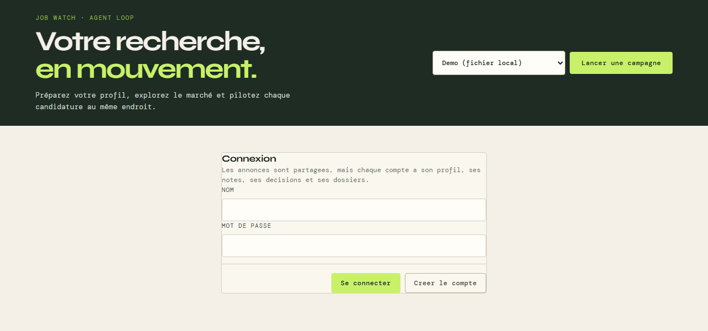
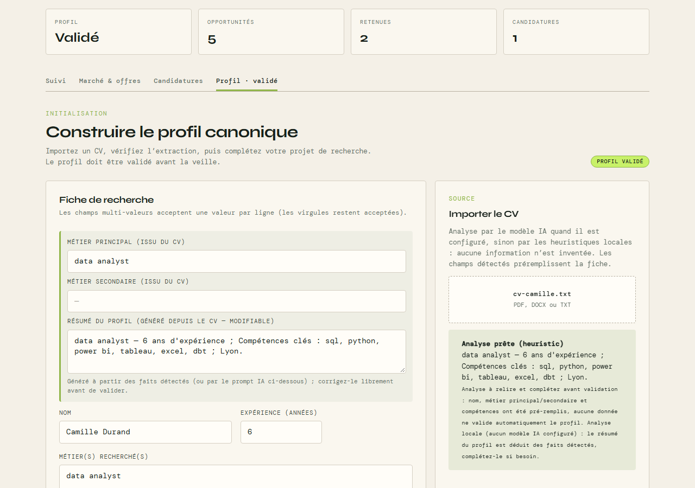
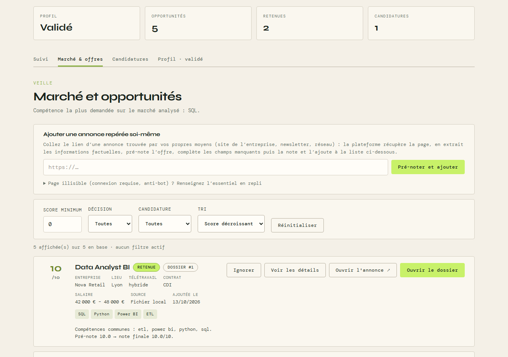
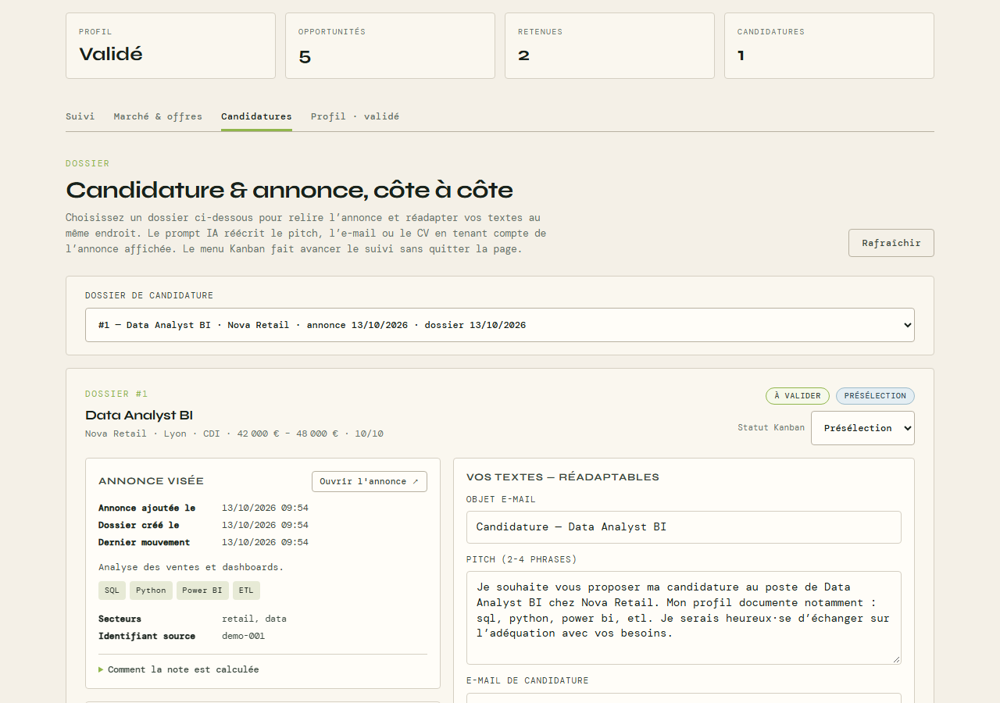
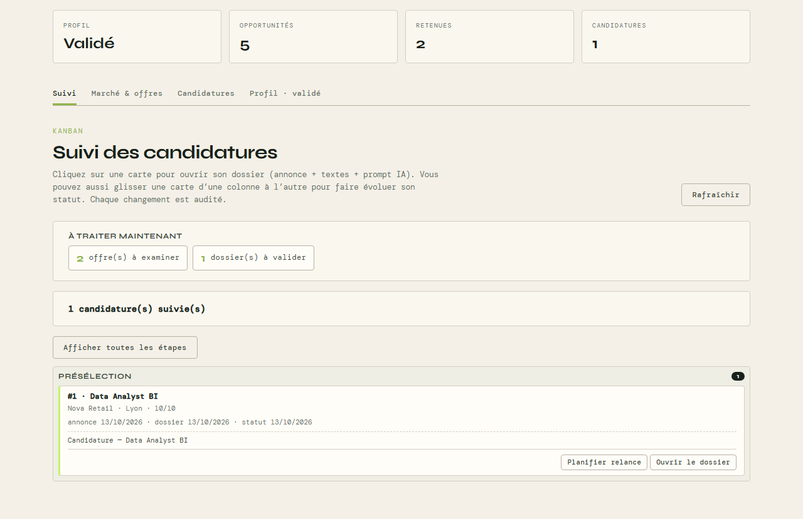

# Job Watch

Un assistant **local** pour votre recherche d'emploi : il surveille les offres,
les note selon votre profil, vous aide à rédiger vos candidatures et suit leur
avancement.

Tout tourne sur votre machine. **Rien n'est envoyé sans votre approbation
explicite**, et les textes générés s'appuient uniquement sur les faits de votre
CV et de l'annonce (aucune expérience ni compétence inventée).

## Ce que vous pouvez faire

- **Importer votre CV** (PDF, DOCX ou TXT) : un profil est extrait, vous le
  relisez, l'ajustez, puis le validez.
- **Surveiller les offres** : jeu de démonstration hors-ligne, ou veille web
  (France Travail, Adzuna, LinkedIn, Indeed, HelloWork).
- **Ajouter une annonce trouvée ailleurs** en collant simplement son lien.
- **Obtenir une note de 0 à 10 par offre**, avec l'explication (compétences
  communes, manques, critères bloquants) et des pondérations réglables.
- **Préparer une candidature** : pitch, e-mail, CV adapté, améliorés en boucle
  par un « rédacteur » et un « évaluateur ».
- **Suivre vos candidatures** : tableau Kanban, relances, historique daté.

## Prérequis

- **Python 3** (développé et testé avec Python 3.14).
- Un navigateur web.
- *Optionnel* : une clé d'API pour un modèle de langage (Anthropic, OpenAI,
  OpenRouter…) afin d'obtenir une analyse de CV et une rédaction plus riches.
  **Sans aucune clé, tout fonctionne** en mode local (heuristiques), avec des
  résultats plus simples.

## Installation et lancement

Ouvrez un terminal à la racine du projet.

### Windows (PowerShell)

```powershell
.\install.ps1     # crée l'environnement .venv et installe les dépendances
.\start.ps1       # prépare la base, importe la démo, lance le serveur
```

- `install.ps1` crée le `.venv` avec `py -3.14`. Si vous avez une autre version
  de Python, remplacez `-3.14` par la vôtre dans ce fichier.
- Si PowerShell refuse d'exécuter les scripts :
  `Set-ExecutionPolicy -Scope Process Bypass`, puis relancez la commande.
- Depuis `cmd`, `start.bat` remplace `start.ps1`.

### macOS / Linux

```bash
./install.sh      # crée l'environnement .venv et installe les dépendances
./start.sh        # prépare la base, importe la démo, lance le serveur
```

### Ouvrir l'application

Une fois le serveur démarré, ouvrez **<http://127.0.0.1:8000>**. La
documentation interactive de l'API est sur **<http://127.0.0.1:8000/docs>**.
Arrêtez le serveur avec `Ctrl+C`.

`install` n'est à lancer qu'une fois ; ensuite, seul `start` est nécessaire.
Au premier lancement, `start` crée la base locale `jobwatch.db` et y importe
quelques offres fictives de démonstration.

> **Réseau** : par défaut le serveur écoute sur toutes les interfaces
> (`0.0.0.0`), donc il est joignable depuis votre réseau local. Pour le garder
> strictement sur votre machine, définissez `JOBWATCH_HOST=127.0.0.1` avant de
> lancer `start`. Le port se change avec `JOBWATCH_PORT` (défaut `8000`).

## Premiers pas dans l'interface

*(Les captures ci-dessous utilisent un candidat et des offres fictifs.)*

### 1. Créez un compte

Sur l'écran de connexion, saisissez un nom d'utilisateur et un mot de passe
(4 caractères minimum), puis **Créer le compte**. Le compte est local à votre
base.



### 2. Importez et validez votre profil

Onglet **Profil** : importez votre CV, relisez la fiche générée, corrigez-la
(ou affinez-la avec une consigne via « Affiner avec l'IA »), puis cliquez sur
**Valider le profil**. Cette validation est indispensable pour noter les
offres.



### 3. Lancez une veille et parcourez les offres

Onglet **Marché & offres** : choisissez la source (**Demo** pour essayer sans
rien configurer, **Web** pour la veille réelle) et cliquez sur **Lancer une
campagne**. Les offres apparaissent avec leur note ; vous pouvez filtrer,
trier, et retenir ou ignorer chaque offre. Une annonce trouvée ailleurs
s'ajoute en collant son lien en haut de page.



### 4. Préparez une candidature

Onglet **Candidatures** : créez un dossier à partir d'une offre retenue
(bouton **Candidater**), générez le pitch et l'e-mail, relisez et corrigez,
puis validez. L'annonce reste affichée à côté de vos textes.



### 5. Suivez l'avancement

Onglet **Suivi** : faites avancer vos candidatures dans le Kanban (envoyée,
présélection, entretien, offre, refusée…). Chaque changement est daté et
audité.



Aucun e-mail réel n'est envoyé : l'envoi passe par un connecteur de démonstration
(`mock`) et n'est possible qu'après approbation du dossier.

## Configuration (facultatif)

Les réglages se font dans un fichier **`.env`** à la racine, à créer à partir
du modèle fourni :

```bash
cp .env.example .env          # Windows PowerShell : Copy-Item .env.example .env
```

Puis décommentez et complétez uniquement ce dont vous avez besoin, et
**redémarrez** le serveur. Le fichier `.env` contient des secrets : ne le
commitez jamais.

| Besoin | Variables à renseigner |
|---|---|
| Utiliser un modèle Anthropic (Claude) | `LLM_PROVIDER=anthropic`, `ANTHROPIC_API_KEY=sk-ant-...` |
| Utiliser OpenAI / OpenRouter | `LLM_PROVIDER`, `LLM_API_KEY`, `LLM_BASE_URL`, `LLM_MODEL_HEAVY`, `LLM_MODEL_LIGHT` |
| Note finale par Jev (OpenRouter) | `OPENROUTER_API_KEY=sk-or-...` |
| Veille France Travail (API officielle) | `FRANCE_TRAVAIL_TOKEN` |
| Veille Adzuna (API publique) | `ADZUNA_APP_ID`, `ADZUNA_APP_KEY` |
| Se passer de compte (usage solo) | `JOBWATCH_SINGLE_USER=1` |
| Changer d'adresse / de port | `JOBWATCH_HOST`, `JOBWATCH_PORT` |

Sans clé de veille, la source Web utilise les pages publiques des sites, dans
la limite d'un quota quotidien volontairement bas (usage personnel, « fair
use »). Un site qui bloque les requêtes automatiques est signalé en erreur dans
le rapport, sans bloquer les autres.

## Dépannage

| Symptôme | Piste |
|---|---|
| `py -3.14` introuvable (Windows) | Installez Python 3.14 ou changez la version dans `install.ps1`. |
| L'écran de connexion gêne en usage solo | `JOBWATCH_SINGLE_USER=1` dans `.env` désactive les comptes. |
| « Validez le profil avant de lancer une campagne » | Onglet Profil → **Valider le profil**. |
| Aucune offre en source Web | Vérifiez le profil (métier, zone) et les diagnostics du rapport de campagne ; essayez d'abord la source **Demo**. |
| Le port 8000 est déjà utilisé | Définissez `JOBWATCH_PORT=8001` puis relancez. |
| Créer un compte sans interface | `python -m app.cli user-create --user camille --password ...` |

## Pour aller plus loin

- **[README.technique.md](README.technique.md)** : architecture, API, scoring,
  scrapers, journalisation, boucle rédacteur ↔ évaluateur.
- **`/docs`** (serveur lancé) : documentation interactive de toutes les routes.
- **Tests** : `pytest -q` (avec `JOBWATCH_DATABASE_URL=sqlite:///...` pour une
  base isolée).
