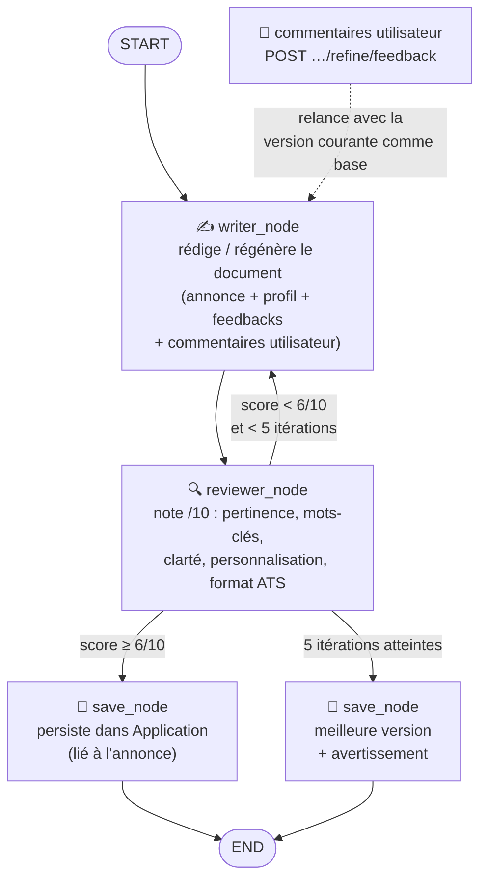

# Job Watch — documentation technique

> Référence détaillée (API, scoring, scrapers, journalisation…).
> Pour installer et lancer le projet, commencez par le [README](README.md).

MVP local de veille et de candidatures assistées.
La **démo** est explicitement fictive; la **veille web** s'appuie sur des
connecteurs conformes (API officielles France Travail / Adzuna) uniquement
lorsqu'elles sont configurées. Aucun envoi d'e-mail réel sans approbation.

## Multi-utilisateurs : annonces partagées, notations personnelles

- **Comptes locaux** : `POST /api/auth/register`, `/api/auth/login` (token
  `Bearer`, `POST /api/auth/logout` pour révoquer), `GET /api/auth/me`. Mot de
  passe haché PBKDF2 (stdlib, sans dépendance), création CLI :
  `python -m app.cli user-create --user camille --password ...`.
- **Annonces partagées** : `jobs` reste le catalogue commun dédupliqué par
  `external_id` (une veille profite à tous).
- **Notation = filtre personnel** : score / confiance / décision / explication
  vivent dans `job_ratings` (unicité `(user_id, job_id)`) ; `GET /api/jobs`,
  `/api/overview`, `/api/kanban` et le compte rendu d'import par lien exposent
  la vue de l'utilisateur courant.
- **Isolés par compte** : profil, candidatures (création, génération, contenus,
  états, relances, statuts, envois), événements pipeline et audit. La
  chronologie d'un dossier (`history`) est reconstruite depuis l'audit du
  dossier demandé (donc visible même si une entrée historique porte
  `user_id IS NULL`).
- **Bases existantes** : migration automatique au démarrage
  (`app/db.py::_ensure_user_columns` : `user_id` sur `profiles`/`events`/
  `applications`/`audits`, création de `users`/`auth_tokens`/`job_ratings`).
  Les lignes historiques gardent `user_id IS NULL`, visibles uniquement en mode
  `JOBWATCH_SINGLE_USER=1` (comportement mono-utilisateur historique, utilisé
  aussi par la suite de tests sauf `tests/test_multiuser.py`).

## Suivi des candidatures : envoi sous approbation, relances, statuts et audit

- **Envoi bloqué sans approbation humaine** : l'application doit être à l'état
  `approved`, avec un destinataire explicite et l'en-tête `Idempotency-Key`
  obligatoires. `POST /api/applications/{id}/send` passe par `mock` par défaut,
  joint un CV texte local de démonstration et journalise l'opération. Les
  adaptateurs Gmail/Outlook ne génèrent que l'URL OAuth (aucun secret embarqué).
- **Idempotence** : une clé déjà envoyée renvoie le même brouillon ; le flag
  `sent` protège contre le double envoi.
- **Relances** : `POST /api/applications/{id}/followup` crée une relance
  `pending_approval` ; `.../followup/approve` l'autorise. `GET /api/report`
  expose les échéances.
- **Suivi / Kanban** : `POST /api/applications/{id}/status?status=screening`
  et `GET /api/kanban` ; chaque changement est audité dans `/api/audit`.
- **Dates et chronologie** (UI desktop) :
  - `jobs.created_at` est estampillé à l'import et exposé par `GET /api/jobs`
    (`created_at`) et par l'annonce d'un dossier (`job.created_at`) ;
  - `GET /api/applications[/{id}]` expose `history`: la chronologie datée du
    dossier (création, générations, retouches manuelles, statuts, relances,
    envois), reconstruite depuis l'audit par
    `app/tracking.py::history_index` (une seule requête pour la liste) ;
  - `GET /api/kanban` expose `job_created_at`, `application_created_at` et
    `status_updated_at` pour dater chaque carte ;
  - une base existante est migrée automatiquement au démarrage
    (`app/db.py::_add_missing_columns` : ajout de `jobs.created_at`, rempli
    avec la date de la première campagne).
- Routes concernées : `/api/oauth/{gmail|outlook}/authorize`,
  `/api/applications/{id}/send`, `/followup`, `/followup/approve`, `/status`,
  `/api/kanban`, `/api/report`. Le CLI reste local et sans credentials externes.

Les vraies intégrations OAuth nécessitent un échange de code, stockage
chiffré/rotation des tokens, scopes minimaux, redirect URI allowlistée et revue
sécurité ; ces éléments sont explicitement laissés à l'implémentation de
production et ne sont pas simulés.

### Journalisation : deux tables, deux périmètres

- `events` = **journal du pipeline** : profil enregistré/validé (`profile`),
  veille importée (`cycle`), campagne (`campaign`), import manuel (`import`) et
  décision sur une offre (`decision`, avec `job_id`). C'est la table lue
  historiquement pour dater l'ajout des offres
  (`app/db.py::_add_missing_columns`). Elle n'est pas exposée par l'API.
- `audits` = **journal du dossier de candidature** : création, génération,
  retouches manuelles, transitions d'état, statuts Kanban, relances et envoi.
  `GET /api/audit` l'expose en clair et `app/tracking.py::history_index` en
  dérive la chronologie (`history`) affichée par dossier et par carte Kanban.
- Conséquence assumée : une action sur un dossier **n'écrit pas** dans `events`
  (elle est tracée dans `audits`, corrélée par `metadata_json["application_id"]`).
  Pour un journal unique, il faudrait brancher `audit()` sur les deux tables.
- Non journalisées volontairement : les opérations de lecture/aperçu
  (`POST /api/cv/import`, `POST /api/profile/refine`, analyse de marché) ne
  persistant rien par elles-mêmes.


## Démarrage

### macOS / Linux
```bash
./install.sh      # crée .venv et installe les dépendances
./start.sh        # initialise la base, importe la démo et lance le serveur
```
Puis http://127.0.0.1:8000 et `/docs`.

### Windows (PowerShell)
```powershell
.\install.ps1     # crée .venv et installe les dépendances
.\start.ps1       # initialise, importe la démo, lance le serveur
```
Alternative cmd : `start.bat`.

## Architecture « LLM ou heuristique »

Chaque API utilise la méthode la plus pertinente pour sa tâche :

| Route | Méthode | Pourquoi |
|---|---|---|
| `POST /api/cv/import` | **LLM (tier `heavy`)** + repli heuristique | extraction riche du CV (nom, métier principal/secondaire, compétences, matrix) |
| `POST /api/applications/{id}/generate` | **LLM (tier `light`)** + repli déterministe | rédaction pitch/e-mail (faits uniquement) |
| `POST /api/search-now` / `campaign/run` | **scraper (connecteurs)** → scoring **heuristique** | collecte normalisée + scoring déterministe, rapide, explicable |
| `GET /api/market` | **heuristique** (agrégats) + `analysis=true` → **LLM heavy** + `summary=true` | comptages déterministes, synthèse narrative et analyse optionnelles |

La **pré-note** des offres est toujours **heuristique** (gratuite, hors réseau). La **note finale** (`score_all`) est calculée par **Jev** (via la [Decisions API OpenRouter](https://openrouter.ai/docs/guides/community/jev-tutorial)) si `OPENROUTER_API_KEY` est configurée, sinon par l'heuristique — voir « Scoring pondéré par profil ».

## Veille web : scraper générique piloté par le profil, fair use

Le connecteur (`app/scrapers.py` + `app/websearch.py`) est **générique et configurable via le profil** :

- La **liste de sources** est lue dynamiquement depuis `data["sources"]` du profil
  (fallback : les 5 sources par défaut). On peut donc activer, par métier, des
  **sites spécialisés** sans rien coder.
- **Les 5 sources par défaut sont réelles** (matrice métier × zone × source,
  comme le workflow n8n `job-agent`) :

  | Source | Méthode |
  |---|---|
  | France Travail | API officielle (token OAuth), sinon page de recherche classique |
  | Adzuna | API publique (clés), sinon page de recherche HTML |
  | LinkedIn | page de recherche publique invités (rendue côté serveur) |
  | Indeed | page de recherche classique (si non bloquée par l'anti-bot) |
  | HelloWork | page de recherche classique (cartes rendues côté serveur) |

  APEC (webservice JSON) et WTTJ (**sitemap officiel** filtré par mots-clés,
  robots.txt interdisant `*/jobs?query=*`) restent disponibles en **opt-in**
  explicite (`sources: ["apec", "wttj"]`) car plus fragiles.
- **Lieux résolus** via `geo.api.gouv.fr` (département `75D`, région `11R`,
  commune INSEE) : France Travail utilise le code lieu + `rayon=10` +
  `offresPartenaires=true`, LinkedIn applique `f_WT=2` en full-remote.
- **Parseurs tolérants** : sélecteurs stricts + replis regex façon n8n, repli
  universel JSON-LD `JobPosting`, cap 25 offres/page, URLs normalisées,
  enrichissement heuristique (contrat/remote/salaire).
- **Diagnostics par requête** (`ok / no_results / blocked / rate_limited /
  http_error / network_error / empty_response / parse_error`, plafond 200
  requêtes) : une URL en échec ne bloque jamais les autres.

- **Fair use** (usage personnel, quelques requêtes/jour) : User-Agent honnête,
  délai aléatoire 2–5 s entre requêtes, quota quotidien (`JOBWATCH_WEB_DAILY_LIMIT`),
  cache disque 6 h, et **aucun contournement** des protections *techniques*
  (403/429/captcha → la source est signalée en erreur dans le rapport, sans
  bloquer les autres — c'est le cas d'Indeed).
  robots.txt est consulté : politique `JOBWATCH_WEB_ROBOTS_POLICY=fair`
  (défaut : accès minimal journalisé même si robots.txt est défavorable) ou
  `strict` (refus des pages interdites).
- Enregistrement d'un connecteur custom via `register_connector(name, fn)`.
- Normalisation vers le schéma `Job` + **déduplication par hash**
  (`external_id`). Option `enrich_skills>true` : complète les skills d'une offre
  depuis sa description via le lexique généraliste.

### Ajouter une annonce repérée soi-même (lien collé)

Quand l'offre est trouvée hors veille (site de l'entreprise, newsletter, réseau),
il suffit de **coller son lien** : la plateforme déroule sur cette annonce le même
pipeline que la veille (`app/manual.py`), puis l'ajoute à la liste.

| Route | Effet |
|---|---|
| `POST /api/jobs/import-url` (body `{"url": "…"}`) | récupère la page, extrait les faits, pré-note, complète les champs manquants, note et ajoute l'annonce |
| `POST /api/jobs/import-url/stream` | idem en SSE (`fetch` → `extract` → `prescore` → `imported`) |

1. **Récupération** : une seule requête via `app/websearch.py::fetch_page`, donc
   la même charte que la veille (User-Agent honnête, robots.txt selon
   `JOBWATCH_WEB_ROBOTS_POLICY`, quota quotidien et cache disque partagés).
2. **Extraction factuelle** (`app/manual.py::parse_offer_page`) : JSON-LD
   `schema.org/JobPosting` en priorité (titre, entreprise, lieu, contrat,
   télétravail, fourchette de salaire, description), puis repli Open Graph /
   `<title>` / `<h1>` / méta description. Le salaire n'est converti que sur une
   base annuelle ou mensuelle **en euros** ; `og:site_name` n'est jamais promu en
   employeur et rien n'est deviné quand la page est muette.
3. **Pré-notation → récupération → notation** : pré-note heuristique (passe 1,
   gratuite), complétion des champs manquants (heuristique locale puis LLM light
   `enrich_offer` si un modèle est configuré) et note finale pondérée — le
   pipeline est celui de la veille (`prescore_and_select`, `upsert_jobs`,
   `score_all`).
4. **Ajout à la liste** : `external_id` dérivé de l'URL **sans paramètres de
   tracking** (`url-<hash>`), donc re-coller le même lien met à jour la même
   offre sans créer de doublon. La provenance
   (`explanation["source"]` = domaine du site) et la pré-note sont conservées
   comme pour les autres imports, et l'opération est journalisée
   (`events.kind="import"`).

Erreurs explicites, jamais contournées : `robots.txt`, anti-bot, page de
connexion ou contenu sans annonce → erreur 400 avec le motif. Le dashboard
propose alors un **repli** (`title`, `company`, `description`, facultatifs dans le
body) qui ne remplit que les champs réellement vides — il ne remplace jamais une
donnée extraite de l'annonce. Un profil validé reste requis, comme pour la veille.

### Pré-notation + complétion ciblée (top-5/site) + note finale

Pour limiter les appels coûteux, l'import suit désormais 3 temps
(`app/sources.py::upsert_jobs`, tous les chemins : web, fichier, CLI) :

1. **Pré-note gratuite (hors-ligne, toutes les annonces)** : lexique
   skills/secteurs + complétion heuristique, puis `score_job` sur dict
   (aucun appel LLM/réseau). Chaque annonce garde sa `_prescore` transitoire
   et sa provenance `_source` (jamais persistées telles quelles).
2. **Infos manquantes ciblées (top-5 par site)** : seules les 5 annonces les
   mieux pré-notées de chaque site reçoivent la passe LLM light (`enrich_offer`,
   tier `light`, sans écraser le scrapé ni inventer). Réglable via
   `JOBWATCH_TOP_N_PER_SOURCE` (défaut `5`).
3. **Note finale** : `score_all` (scoring pondéré 0-10) est calculé après
   enrichissement, sur les champs complétés. La pré-note reste tracée dans
   `Job.explanation["prescore"]` à côté de la note finale `Job.score`.

### Complétion des champs manquants (heuristique + LLM light)

À l'import (`upsert_jobs`, donc tous les chemins : web, fichier, CLI), chaque
offre incomplète est complétée en deux temps, sans jamais écraser une donnée
déjà scrapée ni inventer de fait :

1. **Heuristique déterministe** (gratuite, hors-ligne) : détection du contrat,
   du télétravail, de la ville (lexique) et de la fourchette de salaire dans le
   titre + la description (`app/offer_enrichment.py`).
2. **Passe LLM light** : si des champs structurants manquent encore
   (compétences, contrat, localisation), le modèle léger `LLM_MODEL_LIGHT`
   (prompt `enrich_offer`, tier `light`) extrait de l'annonce uniquement ce qui
   y figure. Réservée aux fournisseurs LLM réels configurés ; repli heuristique
   sinon. Garde-fous : quota par import `JOBWATCH_ENRICH_LLM_MAX` (si défini,
   plafond global ; sinon budget = taille du top-N, ex. 7 sites × 5 = 35 max),
   désactivation complète via `JOBWATCH_ENRICH_LLM=0`.

Branchement : `/api/search-now?source=web` ou `source=<connecteur>` (ex. `france_travail`),
dans `POST /api/campaign/run` idem (le sélecteur « Web (connecteurs du profil) »
du dashboard fait `source=web`). Sans clés, ces connecteurs renvoient `[]` sans
appel réseau — le mode `demo` reste disponible hors ligne.

## Feedback temps réel (SSE)

Pour que l'utilisateur ne reste pas devant un écran immobile, chaque opération
longue existe aussi en version **streamée** (Server-Sent Events,
`text/event-stream`) :

| Route streamée | Étapes diffusées |
|---|---|
| `POST /api/cv/import/stream` | fichier reçu → extraction du texte → analyse (LLM/heuristique) → résultat |
| `POST /api/campaign/run/stream` | connecteurs interrogés un à un (nb d'offres ou erreur par source) → déduplication → pré-notation (top-5/site) → import ciblé → note finale → synthèse et analyse marché → résultat |
| `POST /api/jobs/import-url/stream` | page du lien collé récupérée → extraction des faits (`extract`) → pré-notation et complétion (`prescore`) → note finale et ajout à la liste (`imported`) → résultat |
| `POST /api/search-now/stream` | idem veille, sans analyse marché |

Chaque trame est un JSON : `{"type":"progress","step":...,"message":...}`
(étape en cours), `{"type":"done","result":...}` (même charge utile que les
routes classiques) ou `{"type":"error","message":...}`. Les routes
historiques non streamées restent disponibles avec des réponses strictement
identiques (elles consomment les mêmes générateurs d'étapes). Le dashboard
utilise les versions streamées et affiche un fil d'activité « agent »
(panneau flottant en bas à droite : étapes ✓, spinner sur l'étape courante,
erreurs ✕).

## Scoring pondéré par profil

`app/scoring.py` calcule un score 0–10 **pondéré** par dimension (compétences,
intitulé, expérience, localisation, contrat, salaire, secteur). Les poids sont lus depuis
`data["ponderation"]` du profil (normalisés à la somme 1, avec des valeurs par
défaut stables). L'explication d'une offre expose `weights` et `dimensions`
(sous-scores) pour rester traçable. Les filtres « obligatoires » plafonnent le
score à 3.9 tant qu'ils ne sont pas respectés.

### Note finale par Jev (Decisions API OpenRouter)

Si `OPENROUTER_API_KEY` (clé `sk-or-...` d'OpenRouter) est définie
(`JOBWATCH_SCORER=auto`, défaut), `score_all`
interroge [Jev](https://openrouter.ai/docs/guides/community/jev-tutorial) (`app/jev.py`) :
une requête `POST https://openrouter.ai/api/alpha/decisions` par offre (Decisions
API, modèle `typesafe/jev-1.13`), avec un `state` structuré
(`profil` / `offre`) et une question `type: "score"` par dimension (métier &
missions, secteur, compétences, expérience, localisation, contrat, salaire),
chacune notée sur une grille de 4 niveaux concrets (0 = incompatible → 3 =
adéquation directe).

- Une question n'est posée que si l'offre **et** le profil portent la donnée
  (ex. pas de question « salaire » sans salaire dans l'annonce) ; le poids des
  dimensions omises est redistribué sur les autres.
- Combinaison en code (motif *composite scoring*) : `score / (niveaux - 1)` par
  dimension, moyenne pondérée par `data["ponderation"]`, × 10. La confiance est
  la moyenne pondérée des confiances Jev.
- Plafond 3.9 conservé : une dimension métier/localisation/contrat/salaire
  jugée nettement au niveau 0 (< 0,25) avec une confiance ≥ 0,5, ou une
  exclusion du profil trouvée dans l'annonce, bloque l'offre.
- **Cache** : l'empreinte de la requête est stockée dans
  `explanation["jev"]["fingerprint"]` ; une offre n'est re-notée que si elle, le
  profil ou le modèle changent.
- **Repli** : erreur réseau/quota → note heuristique pour l'offre concernée,
  cause tracée dans `explanation["jev_error"]`. `JOBWATCH_SCORER=heuristic`
  désactive Jev.
- Compétences communes/manquantes (`strengths`, `gaps`) et exclusions restent
  calculées de façon déterministe.

La dimension **expérience** n'est évaluée que par Jev ; en mode heuristique, son
poids est redistribué.

### Heuristique

La dimension **compétences** mesure la **part de la demande de l'offre couverte
par le profil** (`len(compétences de l'offre couvertes) / len(index de l'offre)`),
et l'appariement passe par `app/skills.py` : tokens normalisés (accents, suffixes
de niveau « (8-10) », séparateurs), alias explicites (`dotnet` ↔ `.NET Core`,
`ai` ↔ `ia`, `team` ↔ `équipe`…) et repli du pluriel. Un libellé riche du profil
(« API REST », « Anglais (C1) ») matche donc l'index nu d'une offre (« rest »),
tout en refusant les confusions (`Java` ≠ `JavaScript`). Si l'offre n'a **aucun**
index de compétences (source muette), la dimension est **neutre (5/10)** au lieu
d'être mise à zéro : on ne pénalise pas une offre sur une donnée absente.
L'explication expose `competences_source` (`offre` / `absente` / `profil vide`),
`strengths` (compétences du profil couvertes), `gaps` (compétences demandées par
l'offre **non** couvertes) et `profile_gaps` (compétences du profil hors offre).

Le dashboard intègre un **configurateur graphique de pondération** (curseurs sur
100 % avec total affiché et validation « ✓ / ✕ », boutons *Defaults* et
*Normaliser à 100 %*). Les valeurs (pourcentages) sont stockées en fractions
dans `data["ponderation"]` et appliquées au scoring dès la validation du profil.

## Analyse du marché

`GET /api/market?analysis=true` et la campagne renvoient une **analyse du
marché** qui distingue **faits collectés** (agrégats heuristiques) et
**hypothèses** (suggestions LLM) : tendances, mots-clés de recherche,
séniorités, pistes d'approche, recommandation. En mode local, l'analyse reste
heuristique (la distinction faits/hypothèses est préservée).

## Choix du modèle : puissant vs léger

Deux modèles configurables selon le niveau de la tâche (dans `.env` ou `.env.example`) :

- `LLM_MODEL_HEAVY` — tâches lourdes : analyse CV, synthèse marché.
- `LLM_MODEL_LIGHT` — tâches légères : rédaction pitch/e-mail.
- `LLM_MODEL` — modèle de repli si les deux ne sont pas définis.

Exemple (OpenAI-compatible / OpenRouter) :
```
LLM_PROVIDER=openrouter
LLM_BASE_URL=https://openrouter.ai/api/v1
LLM_API_KEY=...
LLM_MODEL_HEAVY=openrouter/gpt-4o
LLM_MODEL_LIGHT=openrouter/gpt-4o-mini
```

Exemple (Anthropic direct — compte Claude) :
```
LLM_PROVIDER=anthropic
ANTHROPIC_API_KEY=sk-ant-...
LLM_MODEL_HEAVY=claude-sonnet-5-5
LLM_MODEL_LIGHT=claude-haiku-5-5
```
En `auto`, `LLM_API_KEY` sélectionne l'endpoint OpenAI-compatible et
`ANTHROPIC_API_KEY` (seule) sélectionne Anthropic. Sans modèles explicitement
configurés, les défauts sont `claude-sonnet-5-5` / `claude-haiku-5-5` côté
Anthropic.

### Connexion avec un compte Claude (OAuth, sans x-api-key)

Sans clé API, un **compte Claude** (Pro/Max/Team) peut se connecter en OAuth
(flow Authorization Code + PKCE, celui de Claude Code) :

1. `GET /api/oauth/claude/authorize` renvoie l'URL de connexion ;
2. s'authentifier dans le navigateur — le rappel
   `http://localhost:8000/callback` (alias `/api/oauth/callback`) échange le
   code contre des tokens stockés dans `data/claude_oauth_tokens.json` ;
3. les appels LLM utilisent alors `Authorization: Bearer <access_token>` +
   `anthropic-beta: oauth-2025-04-20` — **sans x-api-key** — avec
   rafraîchissement automatique (rotation du refresh token) et nouvelle
   tentative en cas de 401.

Routes : `GET /api/oauth/claude/status`, `POST /api/oauth/claude/logout`.
Un bearer statique est aussi accepté via `ANTHROPIC_AUTH_TOKEN` (ou
`CLAUDE_CODE_OAUTH_TOKEN`, par ex. après `claude setup-token`). La priorité
reste : `ANTHROPIC_API_KEY` (x-api-key) > bearer statique > compte OAuth.

Sans clé API (ou `LLM_PROVIDER=local`), le système fonctionne en mode
déterministe / heuristique : aucune information n’est inventée.

Le client LLM application un **repli réseau robuste** : SDK (`openai` ou
`anthropic`) → appel HTTP direct (endpoint OpenAI-compatible ou Messages API
Anthropic) → mode déterministe/heuristique. Une panne réseau ou de fournisseur
ne casse donc jamais un appel : les tâches retombent sur le comportement local.

## Prompts et mots-clés externalisés

Les prompts ne sont **plus inline** dans le code :

- `app/data/prompts.json` — templates des prompts par tâche (avec leur tier `heavy`/`light`).
- `app/data/keywords.json` — lexique métier généraliste (compétences multi-domaines, intitulés de postes, contrats, villes).

Le chargement se fait via `app/prompts.py` (rendu sans `str.format`, donc tolérant
aux accolades présentes dans les CV ou les schémas JSON).

## Heuristiques généralistes

Le moteur heuristique (`app/heuristics.py`) est **méta-métier** : il ne dépend
d’aucun métier codé en dur mais d’un lexique JSON large et de quelques patterns
linguistiques (années, contrats, télétravail, villes, intitulés). Il fonctionne
ainsi pour tout domaine (développement, data, graphisme, marketing, RH, santé,
finance, juridique…). L’analyse d’un CV renseigne `name`, `main_job`,
`secondary_job`, `jobs`, `adjacent_jobs`, `skills`, `skill_matrix`, etc., et
**ne remplit jamais le profil automatiquement** : la validation reste un acte
humain (`PUT /api/profile` avec `validate_profile:true`). Voir la section
« Profil : résumé généré, compétences sans doublon et prompt d'affinage » pour la
source unique des compétences et l'affinage par consigne IA.

## Profil : résumé généré, compétences sans doublon et prompt d'affinage

- **Résumé toujours renseigné** : `profile_summary` fait partie du schéma
  `analyze_profile` (gabarit `app/data/prompts.json`) ; à défaut de modèle, il est
  déduit localement des faits extraits (`build_profile_summary`) — jamais de
  texte inventé. Le champ reste éditable dans l'interface.
- **Compétences sans doublon** : `skill_matrix` est la **source unique**
  (libellé, catégorie, niveau, preuve) ; `skills` n'en est que la **projection
  plate** utilisée par le scoring, la veille et les faits de candidature.
  L'appariement avec une offre (scoring, `facts_for`, avertissements de qualité)
  est assuré par `app/skills.py` — voir « Scoring pondéré par profil » — pour que
  les libellés riches de la matrice rencontrent le lexique nu des annonces.
  `normalize` (`app/profile_analysis.py`) absorbe les doublons de mot-clé
  (« sql » face à « SQL Server », « git » face à « Git / Git Flow ») sans
  fusionner des compétences distinctes (`Java` / `JavaScript`), et
  `PUT /api/profile` normalise toute fiche reçue (compétences, résumé, salaires,
  ciblage conservés).
- **Fiche complète dans l'interface** : le formulaire expose secteurs,
  exclusions, prétentions salariales et métiers visés ; la matrice est regroupée
  par domaine, avec niveau modifiable et preuve issue du CV. Dans chaque carte de
  compétence, le libellé, le sélecteur de niveau et l'étiquette de catégorie
  occupent des colonnes fixes (grille CSS) : un libellé long ne renvoie plus les
  contrôles à la ligne suivante, donc les cartes restent alignées entre elles.
- **Prompt d'affinage** : `POST /api/profile/refine`
  (`{instruction, name, data, source_text}`) applique une consigne libre
  (« recentre sur Tech Lead à Paris », « ajoute mes compétences Cloud du CV ») à
  la fiche, le CV importé restant la seule base factuelle (gabarit
  `refine_profile`, tier `heavy`). Rien n'est enregistré : la fiche affinée est
  renvoyée puis affichée, l'utilisateur la relit avant d'enregistrer ou de
  valider. Sans modèle configuré : `applied:false` + `warning` explicite.
- Sondes UI manuelles associées : `tests/_profile_probe.py` (import CV + prompt IA
  sur une base jetable) et `tests/_matrix_probe.py` (alignement du niveau et de la
  catégorie dans la matrice, de 760 à 1920 px — captures dans `tests/_shots/`).

## Lot 2 : flux et garanties
1. Valider un profil via `PUT /api/profile` (`validate_profile:true`), importer/shortlister les offres via `POST /api/search-now` et `POST /api/jobs/{id}/decision?value=retained`.
2. `POST /api/applications?job_id=1` crée un dossier à l’état `draft`.
3. `POST /api/applications/{id}/generate` produit pitch, e-mail, compétences à mettre en avant et aperçu CV avant/après. Le fournisseur `DeterministicProvider` local utilise uniquement les faits du profil et de l’offre; aucune nouvelle expérience/compétence n’est créée. Les champs `quality`, `warnings`, `fact_hash` et `diff` rendent la sortie contrôlable.
4. Transitions explicites : `draft -> to_validate -> approved|rejected -> email_draft_created` (ce dernier uniquement après `approved`).
5. `POST /api/applications/{id}/email-draft` utilise le connecteur abstrait `mock`, marque `sent:false`, et ne transmet rien. Journal : `GET /api/audit`.

CLI Lot 1 conservée; Lot 2 : `application-generate ID`, `application-state ID --state approved`, `email-draft ID`.

## Boucle Rédacteur ↔ Évaluateur (LangGraph)

`app/refinement.py` ajoute une **boucle de génération itérative** de pitchs et de
CV optimisés ATS : le **Rédacteur** (LLM) produit une version, l'**Évaluateur**
la note sur 10 selon des critères explicites ; sous le seuil de **6/10**, le
document repart en révision avec le feedback, jusqu'à validation ou plafond de
**5 itérations**. Au plafond, la **meilleure version** observée est sauvegardée
avec un avertissement. L'utilisateur peut aussi injecter ses propres
commentaires : ils relancent le Rédacteur avec la version courante comme base.



### Points d'entrée

| Route / commande | Effet |
|---|---|
| `POST /api/applications/{id}/refine?document_type=pitch\|cv_ats` | Lance la boucle complète pour le dossier |
| `POST /api/applications/{id}/refine/feedback` (body `{"comments": "…"}`) | Relance le Rédacteur avec les commentaires, version courante conservée comme base |
| `python -m app.cli application-refine ID --doc cv_ats` | Idem en CLI |
| `python -m app.cli application-revise ID --comments "Plus percutant"` | Révision guidée en CLI |

La réponse expose `document`, `score`, `iterations`, `status`
(`draft` / `needs_revision` / `validated`), `warnings` et `history`
(journal des itérations avec scores et feedbacks — aussi journalisé via le
logger `jobwatch.refinement`).

### Persistance et garanties

- Le document final est enregistré dans le dossier existant
  (`Application.pitch` ou `Application.cv_after`, lié à l'annonce via
  `job_id`) ; le journal des itérations est conservé dans
  `Application.quality["refinement"]` — **aucune migration de schéma**.
- Chaque exécution est tracée dans la table `Audit` (`kind = "refinement"`).
- Les prompts des deux agents (`writer_pitch`, `writer_cv_ats`, `reviewer`)
  vivent dans `app/data/prompts.json`, éditables sans toucher au code. Ils
  interdisent toute invention de faits (comme le reste du projet).
- Robustesse : retry à backoff exponentiel sur les appels LLM
  (`JOBWATCH_REFINE_LLM_ATTEMPTS`, défaut 2), en complément du repli
  réseau SDK → HTTP du provider ; sans clé API, le mode déterministe local
  fait converger la boucle sans réseau.
- Réglages : `JOBWATCH_REFINE_THRESHOLD` (seuil, défaut `6`) et
  `JOBWATCH_REFINE_MAX_ITER` (plafond, défaut `5`). Le Rédacteur et
  l'Évaluateur utilisent les tiers existants (`LLM_MODEL_LIGHT` pour le
  pitch et l'évaluation, `LLM_MODEL_HEAVY` pour le CV ATS).

## API / dashboard
Le dashboard Lot 1 reste servi sur `/`; les nouvelles routes sont documentées automatiquement dans Swagger. L’intégration UI existante peut appeler les routes `/api/applications` sans dépendance à une clé API.

Le dashboard est pensé **desktop** (deux colonnes dès ~1000 px) :

- onglet **Profil** : formulaire de recherche et carte « Importer le CV »
  côte à côte ;
- onglet **Marché & offres** : chaque carte n'affiche qu'une fois chaque
  information (titre, décision/dossier en tags, entreprise, lieu, télétravail,
  contrat, salaire, source, date d'ajout, compétences, motif de note) ; le
  repli « Voir les détails » ajoute description, secteurs et le calcul de la
  note. Les filtres (score, décision, candidature, tri) sont appliqués côté
  navigateur, en direct, avec compteur « affichée(s) sur N en base » et bouton
  **Réinitialiser** ; la carte **Ajouter une annonce repérée soi-même** accepte
  le lien d'une offre trouvée hors veille (avec un repli intitulé/entreprise/
  description si la page est illisible), affiche le compte rendu
  (extraction, pré-note → note, compétences communes) et rafraîchit la liste ;
- onglet **Candidatures** : l'annonce et la chronologie datée du dossier
  restent collées à l'écran pendant l'édition des textes ; badges d'état et
  boutons d'action sont visuellement séparés ; le panneau « Annonce visée »
  expose un bouton **Ouvrir l'annonce ↗** (nouvel onglet, `rel="noopener"`)
  quand l'URL est connue — sinon un rappel « URL absente dans la source » ;
- onglet **Suivi** : chaque carte Kanban porte les dates d'annonce, de dossier
  et de dernier mouvement.

Côté serveur, chaque requête HTTP (et chaque flux SSE) ferme sa session
SQLAlchemy (`app/main.py::close_request_sessions`) : sans cela le pool se
sature et l'API tombe en `TimeoutError` au bout de quelques onglets.

## Tests
`pytest -q`. Utiliser une base isolée avec `JOBWATCH_DATABASE_URL=sqlite:///...` pour les essais. En production, brancher une implémentation de `LLMProvider` approuvée, en conservant les contrôles de factualité et la validation humaine.
